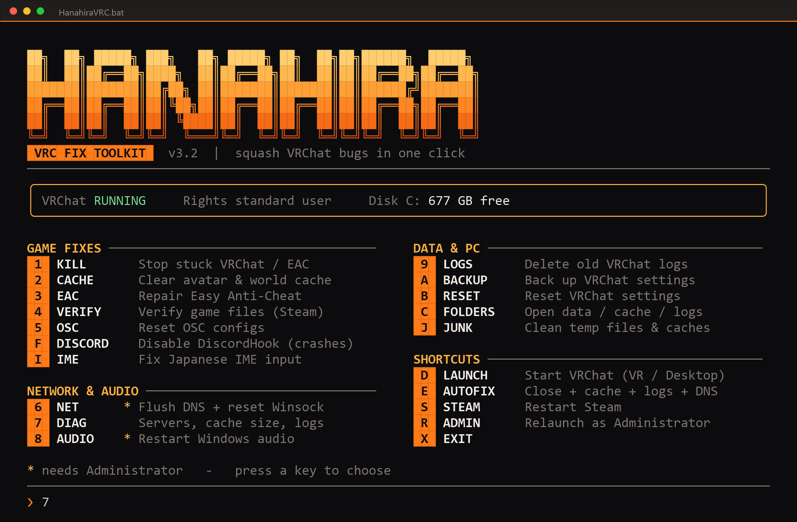
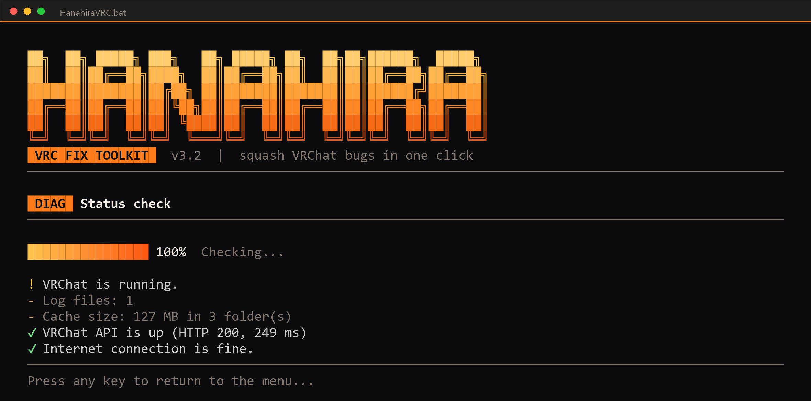

<div align="center">

# 🌸 HanahiraVRC

**A one-click fix toolkit for common VRChat problems on Windows**

🌐 [日本語](README.md) ｜ **English**




[**⬇ Download**](https://github.com/KBYSHanahira/HanahiraVRCTools/archive/refs/heads/main.zip) · [Quick start](#-quick-start) · [Find a fix by symptom](#-find-a-fix-by-symptom) · [FAQ](#-faq)

</div>

> ⚠️ Unofficial fan-made tool. Not affiliated with VRChat Inc.

---

## 📑 Contents

1. [What it does](#-what-it-does)
2. [Quick start](#-quick-start) ← **start here**
3. [Reading the screen](#-reading-the-screen)
4. [Find a fix by symptom](#-find-a-fix-by-symptom)
5. [Tool reference](#-tool-reference)
6. [FAQ](#-faq)
7. [Safety and privacy](#-safety-and-privacy)
8. [Uninstall](#-uninstall)
9. [Developer notes](#-developer-notes)

---

## ✨ What it does

- 🎮 **Game problems** — stop stuck processes, clear cache, repair Easy Anti-Cheat, verify game files, reset OSC
- 💬 **Discord / IME** — work around DiscordHook crashes, diagnose Japanese input not working
- 🌐 **Network & audio** — check VRChat server status, reset DNS / Winsock, restart Windows audio
- 🧹 **PC cleanup** — remove temp files, crash dumps and shader caches, with a size preview first
- 🛡️ **Safe by design** — asks before deleting or changing anything; settings resets are always backed up first
- 📦 **One file** — no installer. Just double-click `HanahiraVRC.bat`

---

## 🚀 Quick start

From download to running takes about a minute.

### Step 1 | Download

**[➡ Click here to download the ZIP](https://github.com/KBYSHanahira/HanahiraVRCTools/archive/refs/heads/main.zip)**

Or use the green **`Code`** button at the top of this page → **`Download ZIP`**.

### Step 2 | Extract

Right-click the downloaded `HanahiraVRCTools-main.zip` → **Extract All...**

> ⚠️ Do not double-click the file from inside the ZIP. It cannot save logs or backups there and will not work properly.
> Extract to a writable place such as your Desktop.

### Step 3 | Run

Double-click **`HanahiraVRC.bat`** in the extracted folder.

On first launch you may see a blue window:

> **"Windows protected your PC"**

This is Windows' standard warning for unsigned tools from individual developers.

1. Click **More info**
2. Click **Run anyway**

> The tool is one plain-text file, so you can open it in Notepad first to read exactly what it does.

### Step 4 | Use it

Just **press the key** shown on the left of each menu item (`1`, `2`, `F`, ...). No Enter needed.

1. Press the key of the fix you want
2. Follow the on-screen prompts (some ask `Y` / `N`)
3. When it finishes, press any key to return to the menu
4. Press **`X`** to exit

### Step 5 | When you need Administrator rights

Items marked with `*` (**NET** and **AUDIO**) need Administrator rights.

- Press **`R`** in the menu to relaunch as Administrator
- Or right-click `HanahiraVRC.bat` → **Run as administrator**

> 💡 **Not sure where to start?** Press **`7` (DIAG)** to check your status, then try **`E` (AUTOFIX)** if the problem is still there.

---

## 💻 Reading the screen



| What you see | Meaning |
|---|---|
| 🟧 Orange block `1`, `F`, ... | The key to press |
| Top box | Whether VRChat is running, your rights, free space on drive C |
| `*` | Needs Administrator rights |
| `✔` / `▲` / `✖` | Success / warning / failure |
| `[Y/N]` | `Y` to continue, `N` to cancel |

> If colours or box drawing look broken, open it in **Windows Terminal** (the default on Windows 11).

---

## 🩺 Find a fix by symptom

| Symptom | Try |
|---|---|
| Game will not start / crashes right after launch | **`3` EAC** → **`4` VERIFY** → **`F` DISCORD** |
| Stuck on the loading screen | **`1` KILL** → **`2` CACHE** |
| Avatars missing / grey / never finish loading | **`2` CACHE** |
| Cannot log in / API errors / unstable connection | **`7` DIAG** to check → **`6` NET** |
| Mic not working / no sound | **`8` AUDIO** |
| Cannot type Japanese | **`I` IME** |
| VRChat crashes or freezes while Discord is open | **`F` DISCORD** |
| OSC apps stopped responding | **`5` OSC** |
| Settings look wrong (graphics / volume will not stick) | **`A` BACKUP** → **`B` RESET** |
| Whole PC feels slow / low disk space | **`J` JUNK** |
| Just fix everything at once | **`E` AUTOFIX** |

---

## 🔧 Tool reference

<details>
<summary><b>🎮 Game problems</b></summary>

| Key | Name | What it does | Notes |
|---|---|---|---|
| `1` | **KILL** | Stops stuck VRChat / Easy Anti-Cheat processes | Unsaved work in the game is lost |
| `2` | **CACHE** | Clears the avatar & world cache (including HTTP / texture caches; honours `cache_directory` in `config.json`) | The next load is a bit slower |
| `3` | **EAC** | Repairs Easy Anti-Cheat. Finds the game across all Steam libraries and launches the EAC setup | In the window, **pick VRChat and click "Repair Service"** |
| `4` | **VERIFY** | Asks Steam to verify the game files | Progress shows in the Steam window |
| `5` | **OSC** | Resets per-avatar OSC configs | The game recreates them on next launch |

</details>

<details>
<summary><b>💬 Discord / Japanese input</b></summary>

| Key | Name | What it does | Notes |
|---|---|---|---|
| `F` | **DISCORD** | Disables DiscordHook. `1` without closing VRChat / `2` and close VRChat too (**recommended**) / `3` restore | Discord is reopened automatically afterwards. Discord updates can bring the hook back - just run it again |
| `I` | **IME** | `1` status check / `2` restart the text input service / `3` relaunch VRChat with the Japanese IME ready / `4` open Windows language settings | VRChat reads the IME **at launch**, so switching in-game does not work |

</details>

<details>
<summary><b>🌐 Network & audio</b></summary>

| Key | Name | What it does | Notes |
|---|---|---|---|
| `6` | **NET** | Flushes the DNS cache and resets Winsock | 🔐 Administrator. Restart your PC to fully apply |
| `7` | **DIAG** | Checks VRChat API status and latency, cache size, log count and internet connection | Changes nothing - safe |
| `8` | **AUDIO** | Restarts the Windows audio service | 🔐 Administrator |

</details>

<details>
<summary><b>🗂️ Data & settings</b></summary>

| Key | Name | What it does | Notes |
|---|---|---|---|
| `9` | **LOGS** | Deletes old VRChat logs | The running game's log is skipped |
| `A` | **BACKUP** | Saves your VRChat settings (registry) to `Backups\` | |
| `B` | **RESET** | Resets VRChat settings | Always backs up first. Your account and avatars are not affected |
| `C` | **FOLDERS** | Opens the data / cache / backups / logs folders | |

</details>

<details>
<summary><b>🧹 PC cleanup</b></summary>

| Key | Name | What it does | Notes |
|---|---|---|---|
| `J` | **JUNK** | Removes temp files, crash dumps, error reports, shader caches (DirectX / NVIDIA) and thumbnail caches | **Shows the list and sizes first and asks before deleting.** Temp files from the last 24 hours are skipped. Emptying the Recycle Bin is a separate question. Cleaning the Windows temp folder needs Administrator |

</details>

<details>
<summary><b>⚡ Shortcuts</b></summary>

| Key | Name | What it does |
|---|---|---|
| `D` | **LAUNCH** | Starts VRChat (VR / Desktop mode) |
| `E` | **AUTOFIX** | Stop processes + clear cache + delete logs + flush DNS in one go, then offers to launch VRChat |
| `S` | **STEAM** | Restarts Steam |
| `R` | **ADMIN** | Relaunches as Administrator (hidden when already elevated) |
| `X` | **EXIT** | Exit |

</details>

---

## ❓ FAQ

<details>
<summary><b>It opens and closes immediately</b></summary>

Did you open it from inside the ZIP? **Extract the ZIP first**, then run `HanahiraVRC.bat` from the extracted folder.

</details>

<details>
<summary><b>No colours / the logo or lines look broken</b></summary>

It was probably opened in an old console. Use **Windows Terminal** (default on Windows 11). On Windows 10, install "Windows Terminal" from the Microsoft Store and run `HanahiraVRC.bat` inside it.

</details>

<details>
<summary><b>"Windows protected your PC" appears</b></summary>

That is the standard warning for unsigned tools. Click **More info → Run anyway**.

</details>

<details>
<summary><b>My antivirus flagged it</b></summary>

Because it stops processes, deletes files and changes system settings, it can occasionally trigger a false positive. If you are unsure, open `HanahiraVRC.bat` in Notepad and read it - all of the source is in that one file.

</details>

<details>
<summary><b>It says "needs Administrator" / NET and AUDIO do not run</b></summary>

Press **`R`** in the menu to relaunch as Administrator, or right-click the file and choose **Run as administrator**.

</details>

<details>
<summary><b>"VRChat install folder not found" (EAC)</b></summary>

Automatic detection only supports the Steam version of VRChat. If you installed it elsewhere, run `EasyAntiCheat*Setup.exe` inside the `EasyAntiCheat` folder of your VRChat install manually and choose **Repair Service**.

</details>

<details>
<summary><b>CACHE says "No cache found"</b></summary>

It was already cleared or is empty. Press `7` (DIAG) to see the current size.

</details>

<details>
<summary><b>Japanese input is still not working</b></summary>

1. Use **`I` → `3`** to relaunch VRChat with the Japanese IME ready
2. Before the game window opens, press `Win + Space` until the IME shows 「あ」
3. If it still fails, use **`I` → `4`** to open Windows language settings and try the Microsoft IME compatibility option ("Use previous version of Microsoft IME")
4. If you use ATOK or another IME, switch to Microsoft IME and test again

</details>

---

## 🔒 Safety and privacy

- **Your personal files are never touched.** It only targets VRChat data, temp files, caches and crash dumps
- It **asks before** deleting or changing anything. Registry resets are **always backed up first**
- It does not collect or send data. The only network use is **`7` DIAG**: a request to `api.vrchat.cloud` and a ping to `1.1.1.1`
- Everything it does is written to `Logs\HanahiraVRC.log`
- Things that can change your system (all with confirmation)
  - **F DISCORD**: renames Discord's `DiscordHook*.dll` to `.disabled` (reversible)
  - **I IME**: only if needed, sets the default input method to the Japanese IME
  - **6 NET**: resets Winsock (restart required)

---

## 🚮 Uninstall

There is no installer, so just **delete the extracted folder**.

To undo changes you made:

| Changed | How to undo |
|---|---|
| Disabled DiscordHook | **`F` → `3`** to restore |
| Reset VRChat settings | Double-click the `.reg` file in `Backups\` to restore |
| Set Japanese IME as default input | Windows Settings → Time & language → Language & region |

---

## 🧰 Developer notes

- The `.bat` is a small launcher; the tool itself is **PowerShell** embedded after the `#<PS>` marker in the same file
- `cmd.exe` misreads LF-only batch files, so keep the file saved with **CRLF** (kept by `*.bat -text` in `.gitattributes`)
- PowerShell variables are case-insensitive (`$r` and `$R` are the same variable)
- For non-interactive testing, use the `HVRC_KEYS` (keys to press) and `HVRC_COLS` (screen width) environment variables

```powershell
$env:HVRC_KEYS = "7X"      # run DIAG, then exit
.\HanahiraVRC.bat
```

---

<div align="center">

**[MIT License](LICENSE)** · Made with 🧡 for VRChat

</div>
